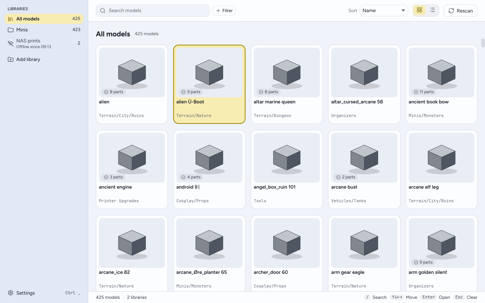

# printdex
Your STL library, organized. Local-first, blazing fast, built in Rust.



## Status

Early development. The desktop app shows your libraries as a searchable grid or list, opens a model to show its parts and other files, filters by format and part count, and has Settings for libraries and appearance (seven colour themes, light/dark/system, translucency, reduce motion). Real previews, tags, collections and the print log come in later milestones (see the issues).

## Run it

Needs Rust (stable, 1.94 or newer).

```sh
# Desktop app
cargo run --release -p printdex-app

# Separate data and settings folders, or light/dark for this run only
cargo run --release -p printdex-app -- --data-dir /tmp/printdex-test --config-dir /tmp/printdex-test --mode dark

# Command line: scan a folder, search, stats
cargo run --release -p printdex-cli -- scan ~/Models
cargo run --release -p printdex-cli -- search dragon
```

In the app, **Add library** picks a folder and scans it.

| Key | Does |
|---|---|
| `/` or Ctrl+F | Search |
| Arrow keys, Home, End | Move through the grid or list |
| Enter or double-click | Open the selected model |
| ← → (in a model) | Pick a part |
| O (in a model) | Open the part with your default app |
| Esc | Back to the library, close the filter menu, clear the search, then the selection |
| Ctrl+, | Settings |

Printdex never changes, moves or uploads your model files. **Show in folder** and **Open** hand a file to your file manager or default app; **Remove library** forgets Printdex's records and leaves the folder alone. A library on an unplugged drive or unmounted NAS stays browsable and shows as offline until it is back.

Where things live:

| | Linux | macOS | Windows |
|---|---|---|---|
| Database | `~/.local/share/printdex` | `~/Library/Application Support/Printdex` | `%APPDATA%\Printdex\data` |
| `settings.toml` | `~/.config/printdex` | `~/Library/Application Support/Printdex` | `%APPDATA%\Printdex\config` |

Translucent glass needs a desktop that can blur behind windows (macOS, KDE Plasma). Elsewhere, and with Translucency set to Off, Printdex uses solid colours.
