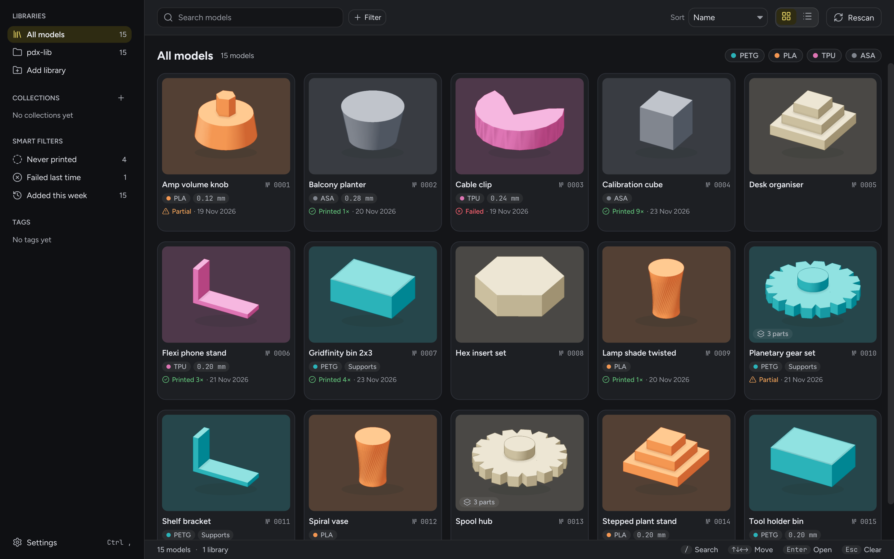
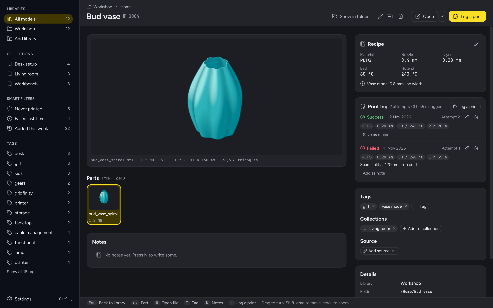

# Printdex

A desktop app for keeping a library of 3D-printing models in order, and for remembering how each one printed.

Point Printdex at the folders where your STL, 3MF and OBJ files already live. It finds the models, draws a preview of each one, and gives you search, tags and collections on top. For every model you can keep a recipe (material, nozzle, temperatures, the quirks it needs) and a log of each print attempt, so the next time you print it you know what worked.

It runs on Windows, macOS and Linux, needs no server or account, and works on libraries stored on a NAS as well as on a local disk.

> [!NOTE]
> Most of the code in this repository was written by an AI model (Claude), with [@wolfedme](https://github.com/wolfedme) deciding what gets built and reviewing the changes.

<picture>
  <source media="(prefers-color-scheme: light)" srcset="docs/screenshots/readme/grid-light.png">
  
</picture>

## Status

Printdex is in active development and has not had a release yet. You can build it from source today (see below). Expect rough edges, and expect the database format to change before 1.0.

## What it does

**Library**

- Scans folders on local disks, external drives and network shares. A folder with printable files is a model; the files in it are its parts.
- Search by name and path as you type, filter by format, material or single and multi-part models, and browse by tag or collection. Grid and list views.
- A preview for every model and part: the picture embedded in a 3MF, an image from the model's folder, or a render in the model's material colour.
- A 3D view of each part that you can turn, move and zoom. Large meshes are simplified for smooth handling.
- A library on an unplugged drive or unmounted share stays browsable and is marked offline until it comes back. Renamed or moved models keep their data.

**Organising and print log**

- Tags, collections, notes and a source link for each model, plus a catalogue number (№ 0412) that is never reused.
- A recipe per model: material, nozzle, layer height, temperatures, supports, adhesion, things it needs, and per-part overrides.
- A print log: result (success, partial, failed), the settings you used, how long it took, notes and photos. A good attempt can be saved as the recipe.
- Smart filters such as *Never printed* and *Failed last time*.

**Files**

- Rename, move and delete models from the app, with undo. Deleted files go to the system trash.
- *Show in folder* and *Open with* hand a file to your file manager, slicer or any other app.

**Keeping your data safe**

- Backups of Printdex's data, and optionally the model files, to a folder, S3-compatible storage, WebDAV or SFTP (SFTP on Linux and macOS). Backups are deduplicated, compressed and can be encrypted with a passphrase. Restore a whole install or a single model.
- Two-way sync of tags, recipes, print log and the rest between computers, through a shared folder or any of the backup targets. Model files themselves are not synced.

<p align="center">
  
</p>

## Your files

Printdex reads your model files and never changes them. What it adds is stored in its own database and, unless you turn it off, in a small sidecar file next to each model (`.printdex.toml` in a model folder, `.<file name>.printdex.toml` for a single file). Sidecars are plain TOML, so your tags, recipes and print log travel with the models and survive a reinstall.

Nothing leaves your computer unless you set up a backup or sync target yourself.

## Building from source

You need Rust 1.94 or newer.

```sh
git clone https://github.com/wolfedme/printdex
cd printdex
cargo run --release -p printdex-app
```

Click **Add library** and choose a folder with your models.

Some useful options while trying it out:

```sh
# Keep data and settings in a separate folder, and force dark mode for this run
cargo run --release -p printdex-app -- --data-dir /tmp/printdex --config-dir /tmp/printdex --mode dark

# Command-line tool: scan a folder, search, show counts
cargo run --release -p printdex-cli -- scan ~/Models
cargo run --release -p printdex-cli -- search vase
cargo run --release -p printdex-cli -- stats
```

## Keyboard

| Key | Action |
|---|---|
| `/` or Ctrl+F | Search |
| Arrow keys, Home, End | Move through the grid or list |
| Enter | Open the selected model |
| Ctrl+A | Select all |
| F2 | Rename |
| Delete | Move to trash |
| Ctrl+Z | Undo the last file change |
| Esc | Go back, close a menu or clear the search |
| Ctrl+, | Settings |

In a model:

| Key | Action |
|---|---|
| ← → | Pick a part |
| O | Open the part in your default app |
| T | Add a tag |
| N | Edit notes |
| L | Log a print (Ctrl+Enter saves it) |

On macOS, use Cmd instead of Ctrl.

## Where data is stored

| | Linux | macOS | Windows |
|---|---|---|---|
| Database and preview cache | `~/.local/share/printdex` | `~/Library/Application Support/Printdex` | `%APPDATA%\Printdex\data` |
| `settings.toml` | `~/.config/printdex` | `~/Library/Application Support/Printdex` | `%APPDATA%\Printdex\config` |

Removing a library in Printdex forgets its records and leaves the folder alone.

## Notes by platform

The translucent window background needs a desktop that can blur behind windows (macOS, KDE Plasma). Elsewhere, or with *Translucency* turned off in Settings, Printdex uses solid colours. Previews are drawn on the GPU when one is available and on the CPU otherwise.

## Project layout

| Crate | What it is |
|---|---|
| `printdex-core` | The engine: scanning, database, search, sidecars, file actions, backup and sync. No UI code. |
| `printdex-mesh` | STL, 3MF and OBJ readers and mesh simplification. |
| `printdex-render` | Preview rendering and the 3D viewer (wgpu, with a CPU fallback). |
| `printdex-app` | The desktop app, built with [iced](https://iced.rs). |
| `printdex-cli` | The `printdex` command-line tool and benchmarks. |

Design notes are in [`docs/`](docs/), the visual design in [DESIGN.md](DESIGN.md).

## Contributing

Bug reports and ideas are welcome as [issues](https://github.com/wolfedme/printdex/issues). Pull requests from outside the project are not being accepted yet; [CONTRIBUTING.md](CONTRIBUTING.md) explains why and has notes for working on the code. Security problems: see [SECURITY.md](SECURITY.md).

## License

[GPL-3.0](LICENSE).
